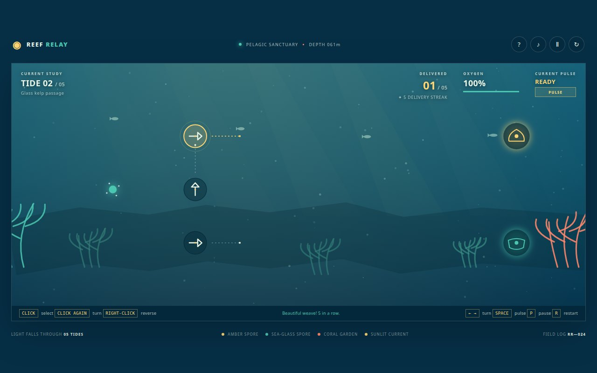
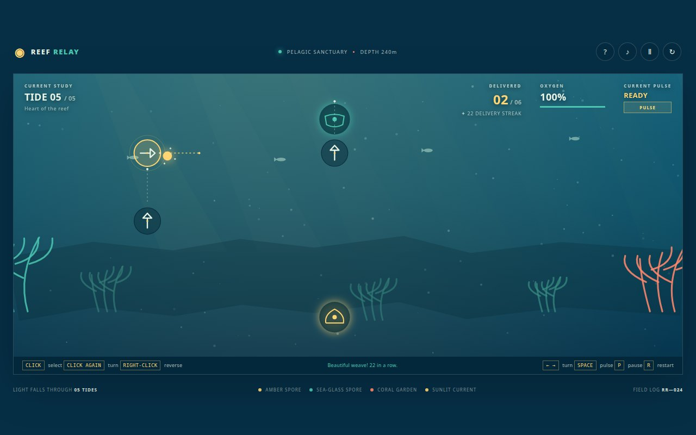
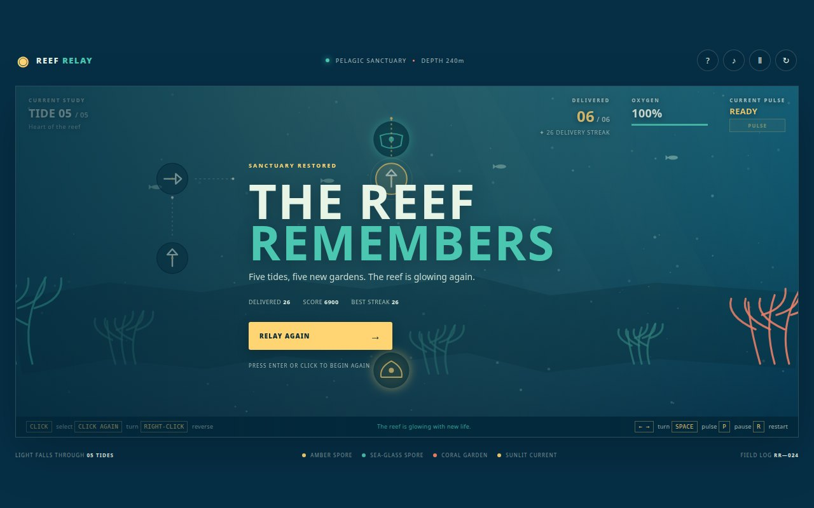

# Reef Relay

[](https://make.fun/bounty/best-game-01?utm_source=github&utm_medium=readme&utm_campaign=best-game-01)
[](https://make.fun/bounty/best-game-01/leaderboard?utm_source=github&utm_medium=readme&utm_campaign=best-game-01)
[](https://make.fun/bounty/best-game-01?utm_source=github&utm_medium=readme&utm_campaign=best-game-01)

An original offline browser puzzle about bending underwater currents to guide glowing spores into coral gardens of matching color. Rotate the currents, manage oxygen, and clear five tides to restore the reef.


## Gallery

| Title | Current routing | Heart of the reef | Sanctuary restored |
| --- | --- | --- | --- |
| [](screenshots/01-title.jpg) | [](screenshots/02-current-routing.jpg) | [](screenshots/03-heart-of-the-reef.jpg) | [](screenshots/04-sanctuary-restored.jpg) |

## Run it

Open `game/index.html` directly in a desktop browser. No install, build, or network connection is required. Alternatively, serve the game locally:

```sh
cd game && python3 -m http.server 8080
```

Then open `http://localhost:8080`.

## How to play

- Select a current well with a click; click it again to turn clockwise. Right-click turns it counterclockwise.
- Use Left/Right or A/D to turn the selected well, and Up/Down or W/S to select another.
- Press Space or Enter, or use the on-screen `PULSE` button, to nudge spores forward. The pulse recharges over time.
- Match amber spores to fan-shaped amber gardens and sea-glass spores to cup-shaped gardens. Wrong deliveries and missed spores cost oxygen; zero oxygen ends the run.
- Clear all five tides. Wrong gardens and spores that drift too long or escape reduce oxygen; oxygen carries between tides and zero ends the run. P pauses or resumes, and R restarts.

## Field guide

Read each spore's color and the local exit shown at its next well. Routes become more complex as you progress. Use the pulse when a spore needs a nudge, and restart after oxygen runs out.

## Quality checks

Run `node tests/model.test.cjs` for deterministic simulation checks. Check JavaScript syntax with `for f in game/src/*.js; do node --check "$f"; done`. The game uses plain JavaScript and local assets and also runs from `file://`.

## Known limitations

The game has a compact five-tide campaign. Scores and settings are not saved.

## License

MIT. See [LICENSE](LICENSE).

## make.fun bounty

Built for the [make.fun “Make the best game” bounty](https://make.fun/bounty/best-game-01). Prize placement is not guaranteed.
